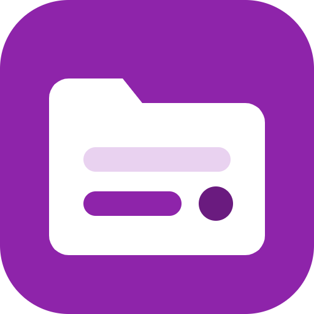
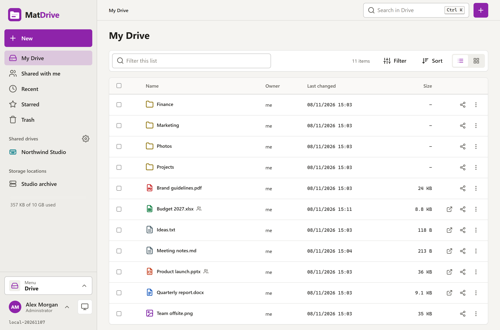
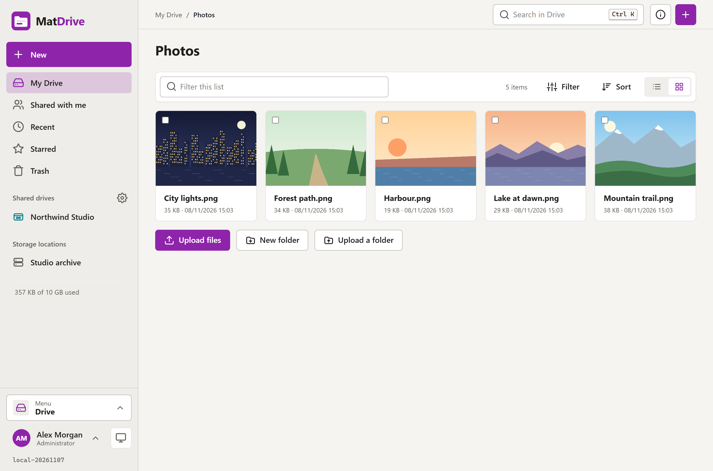
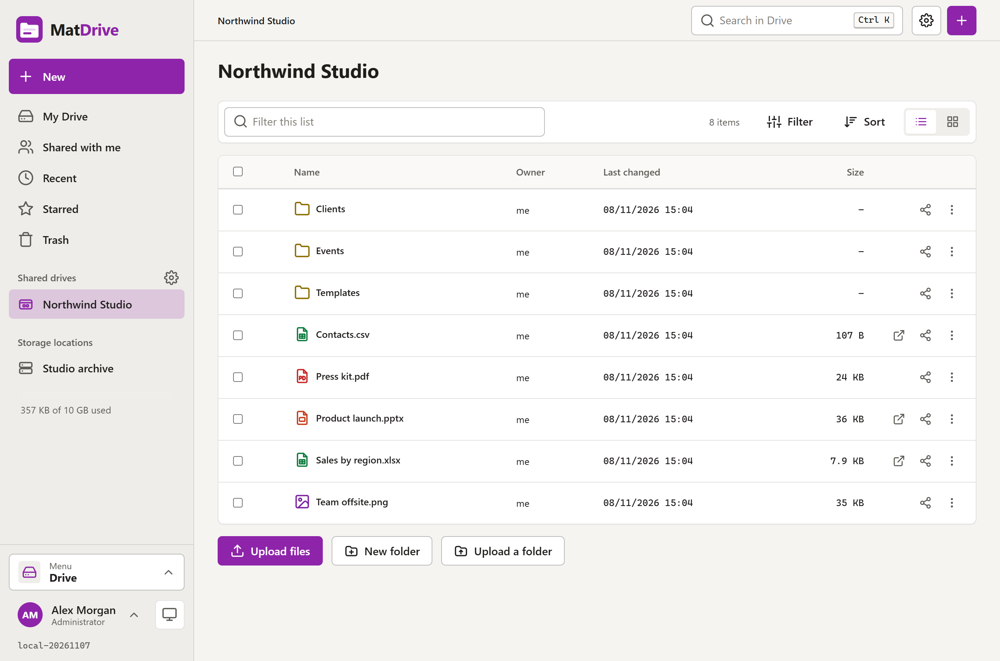
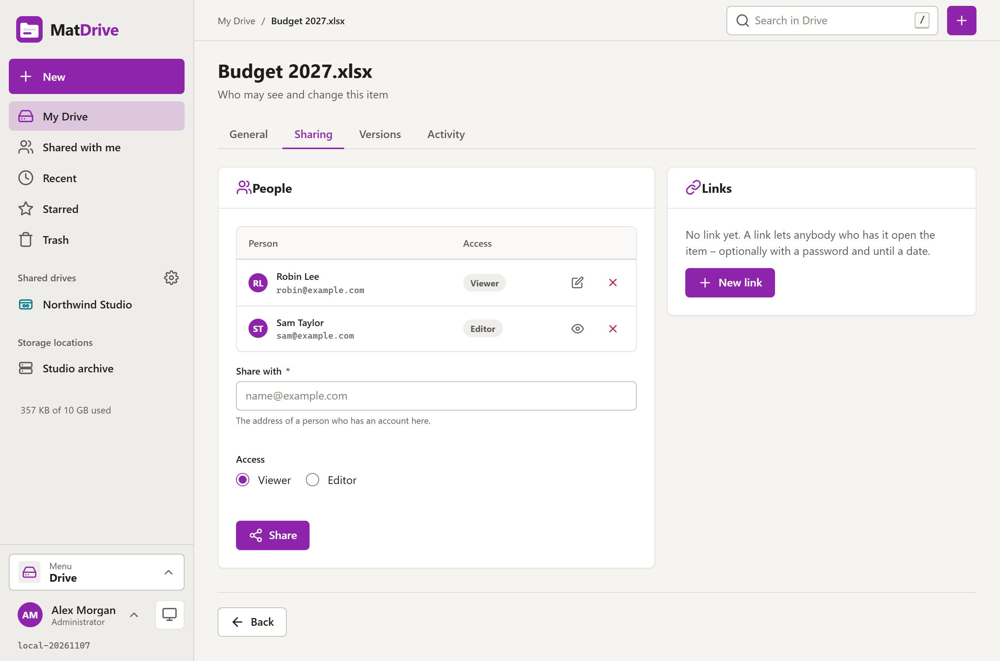
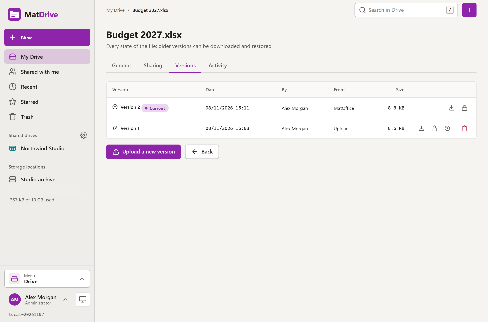
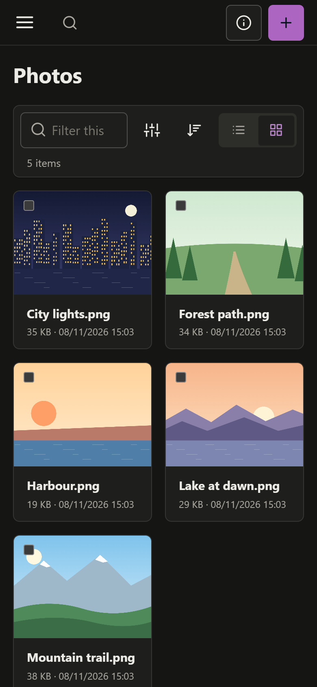
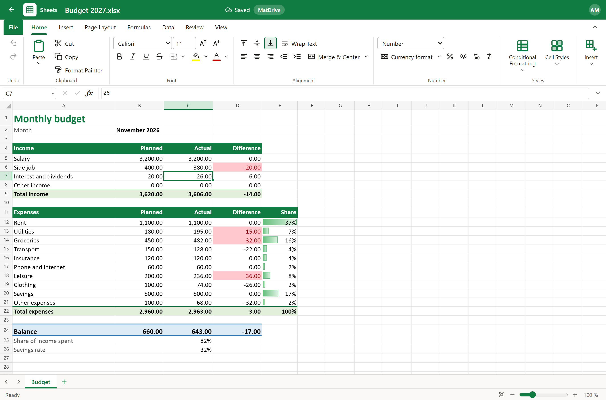
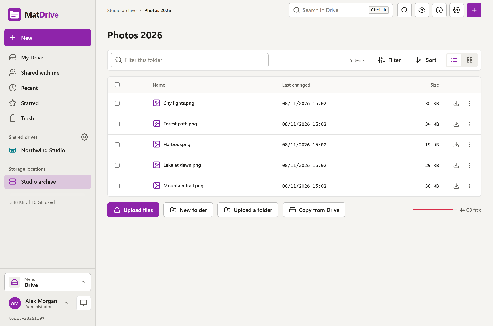

<div align="center">



# MatDrive

**Your files in the browser – drives, sharing, versions, WebDAV.**

A self-hosted drive like the cloud drives people know: My Drive for everyone, shared drives for teams, sharing with people and through links,
the storage locations of a NAS, and office files that open in MatOffice. One container plus PostgreSQL.

</div>



---

## What it does

| Area | What you get |
|---|---|
| **My Drive** | Folders and files of every person; upload (also drag & drop and whole folders, large files in pieces), download, zip and unzip, preview, a text editor, move, copy, rename |
| **Shared drives** | Drives of a team with members as Viewer, Editor or Manager; the files belong to the drive, not to a person |
| **Sharing** | With people (viewer or editor) and through links: a password, an expiry date, and folder links that others can upload into |
| **Versions** | Every upload of a file with the same name and every save keeps the old state; restore or download a version (kept for the days the administrator sets) |
| **Find** | Recent, starred, shared with me, search by name and by the text of text files, the trash (kept for the days the administrator sets) |
| **Storage locations** | The folders of a NAS next to the drives, like MatFile: local folders of the container, SMB, SFTP, FTP and WebDAV; administrators add them and say who may read or write |
| **WebDAV** | Every drive as a network drive at `/dav/` – for the Explorer, the Finder and sync programs – signed in with an app password |
| **MatOffice** | Word, Excel and PowerPoint files (and the MatOffice formats) open in MatOffice, its own container; saving makes a new version in MatDrive |
| **Administration** | People and their quota, the activity log, storage, integrations, system |

English and German, light and dark, a phone layout, and an installable app (PWA); without a network the pages you opened can still be read.

| | |
|---|---|
|  |  |
|  |  |

<p align="center"></p>

## Quick start

```yaml
name: matdrive

services:
  web:
    image: ghcr.io/real-ttx/matdrive:latest
    restart: unless-stopped
    ports:
      - "4810:4810"
    volumes:
      - web-data:/data
    depends_on:
      db:
        condition: service_healthy

  db:
    image: postgres:17
    restart: unless-stopped
    environment:
      POSTGRES_DB: matdrive
      POSTGRES_USER: matdrive
      POSTGRES_PASSWORD: matdrive
    volumes:
      - db-data:/var/lib/postgresql/data
    healthcheck:
      test: ["CMD-SHELL", "pg_isready -U matdrive -d matdrive"]
      interval: 5s
      timeout: 5s
      retries: 20

volumes:
  web-data:
  db-data:
```

Open **http://localhost:4810**; the first account that registers is the administrator. The files themselves are in the volume of `web`
(`/data/files`), the database keeps the folders, names, versions and rights.

| Tag | Built from |
|---|---|
| `ghcr.io/real-ttx/matdrive:latest` | `main` (release) |
| `ghcr.io/real-ttx/matdrive:nightly` | `dev` (development) |

## Office files with MatOffice

MatOffice is the office suite of the family (Docs, Sheets, Slides, Base) and runs in its own container. MatDrive uses it through the capability
**`office.edit`** of the Mat app model (MatPlatform 2.2): MatOffice provides it, MatDrive consumes it (optional). A connection is three values: the
address of MatOffice for the browser, optionally its address for the server of MatDrive (inside Docker), and a key that MatOffice made for MatDrive.
Connected means on; nothing else switches it.

- **With Mattiverse** nothing is to do: it connects the two by itself and hands MatDrive the variables `MAT_OFFICE_EDIT_URL`,
  `MAT_OFFICE_EDIT_INTERNAL_URL` and `MAT_OFFICE_EDIT_KEY` (and `MAT_INTERNAL_URL`, where MatOffice reaches MatDrive). *Administration → Connections*
  shows the connection as *By the variables*.
- **By hand**, without Mattiverse:
  1. In **MatOffice**: *Connections → Connect an app by hand*, name *MatDrive*. MatOffice shows the address and the key once.
  2. In **MatDrive**: *Administration → Connections → Opens office files with*: enter the address, the internal address (when both run in Docker,
     e.g. `http://host.docker.internal:4820`) and the key, and *Save*. It shows *Entered here*.
  3. When MatOffice cannot reach MatDrive at its public address (inside Docker), set *Administration → System → Advanced → Address of MatDrive for
     other apps* (e.g. `http://host.docker.internal:4810`).
- **Or with variables** in the compose file of MatDrive (`MAT_OFFICE_EDIT_*` as above); they win over the values entered by hand, which come back when the
  variables go.

MatDrive asks MatOffice which files it opens right after a connection is made and every six hours (*Check now* on the page Connections asks at once). While
MatOffice does not answer, office files open in the preview and `/api/health` reports `office.edit` as `degraded`. The settings of the old page
*Integrations* (before MatPlatform 2.2) become the connection entered by hand at the first start, once.

After that, *New* offers a document, a spreadsheet, a presentation and a database, and office files open in MatOffice in a new tab. MatOffice reads and
saves the file through a time-limited token of that one file; every save becomes a new version in MatDrive (saves of ten minutes count as one version).



## Storage locations

Folders of the server and shares of other machines, browsed live next to the drives – the functions of the sister app MatFile. An administrator adds
them under *Administration → Storage locations* (*Test connection* checks the address and the account) and decides who may use them: everyone as
viewer or editor, or only the people of a list; a location can also be read-only or switched off. The menu shows each location with a mark whether it
can be reached.

| Type | What it needs |
|---|---|
| Local folder | A folder below `/storage` in the container: mount it into the compose file of MatDrive (see below) |
| SMB | Host, port, share (empty = all shares as folders), user, password, domain |
| SFTP | Host, port, user, password or private key |
| FTP | Host, port, user, password, FTPS |
| WebDAV | Address, user, password |

In a location: upload (files and folders, also by drag & drop), download (a selection as zip), new folder, rename, delete, move and copy inside it and to
another location, copy from and to My Drive or a shared drive, unzip, preview, the text editor, properties, search. Passwords and keys are kept encrypted.



A local folder of the NAS goes into the `web` service of the compose file:

```yaml
    volumes:
      - web-data:/data
      - /srv/photos:/storage/photos        # then add a local location with the folder /storage/photos
```

## WebDAV

Every person reaches their files at `https://<your address>/dav/`: the top level holds *My Drive*, *Shared drives* and *Shared with me*, and a folder can
be connected directly too (`https://drive.example.com/dav/My Drive/`). Sign in with the e-mail address and an **app password** (*Account → App
passwords*: one per device or program, shown once, revoke it any time; a revoked one stops working within two minutes). A local account may also use its
own password; an account that signs in through MatIdentity needs an app password. Use HTTPS: the password goes with every request.

| System | How |
|---|---|
| Windows | Explorer → *This PC* → *Map network drive* → folder `https://drive.example.com/dav/`, tick *Connect using different credentials*. Or: `net use Z: https://drive.example.com/dav/ /user:ada@example.com * /persistent:yes`. Windows sends passwords only over HTTPS; for plain `http://` in a LAN an administrator sets `BasicAuthLevel` = 2 under `HKLM\SYSTEM\CurrentControlSet\Services\WebClient\Parameters` and restarts the WebClient service. Files over 50 MB need a higher `FileSizeLimitInBytes` there. |
| macOS | Finder → *Go* → *Connect to Server* (⌘K) → `https://drive.example.com/dav/` → *Registered User*. |
| Linux | GNOME Files: *Other Locations* → `davs://drive.example.com/dav/`; KDE Dolphin: `webdavs://drive.example.com/dav/`; or davfs2 (`mount -t davfs https://drive.example.com/dav/ /mnt/matdrive`). |
| rclone | `rclone config create matdrive webdav url=https://drive.example.com/dav/ vendor=other user=ada@example.com pass=APP-PASSWORD --obscure`, then e.g. `rclone copy ./photos "matdrive:My Drive/Photos"`. |

The rights of the drive apply (a viewer can read but not write), and so do the quota, the versions (saves within two minutes count as one) and the trash.
Locks are kept in memory: one instance of MatDrive, and a restart forgets them.

## Mat platform

`/api` (description), `/api/health`, `/api/state`, `/api/configure`, `/api/actions`, `/api/connections` after the platform contract 2 of MatDesign
(MatPlatform 2.2; `MAT_API_KEY` or a token of MatIdentity). MatDrive consumes `office.edit` (MatOffice, see above), `identity.oidc` (sign-in through MatIdentity:
`MATIDENTITY_AUTHORITY`, `MATIDENTITY_CLIENT_ID`, `MATIDENTITY_CLIENT_SECRET`, `MATIDENTITY_INTERNAL_URL`) and `mail.smtp` (MatSMTP: `MATSMTP_HOST` …);
*Administration → Connections* shows all three. It adds to the home screen of Mattiverse the icon *Drive* (its menu: *Shared with me*, *Recent*,
*Starred*, *Trash*) and, for administrators, the widgets *Storage* and *Active users*. `MAT_PUBLIC_URL` sets the public address (then fixed on
*Administration → System*), `MAT_INTERNAL_URL` the address where other apps reach MatDrive, `MAT_FRAME_ANCESTORS` who may show it in a frame. All optional,
set by Mattiverse; MatDrive does its whole job without any of them.

## Development

```bash
docker compose -f docker-compose.local.yml up -d --build    # http://localhost:4810, pgAdmin http://localhost:4811
dotnet build MatDrive.slnx
dotnet test MatDrive.slnx                                   # database tests with MATDRIVE_TEST_DB (see CLAUDE.md)
```

`./scripts/redeploy.ps1` rebuilds the local stack (`-Clean` for empty volumes). Conventions and the map of the code: [CLAUDE.md](CLAUDE.md).

## Branches & versioning

| Branch | Purpose | Version |
|---|---|---|
| `main` | Release | `<major>.<minor>.<build>-<yyyyMMdd>` |
| `dev` | Development | `nightly-<build>-<yyyyMMdd>` |
| local | – | `local-<yyyyMMdd>` |
